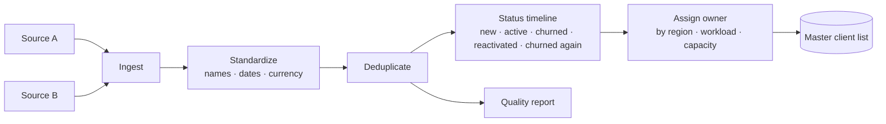
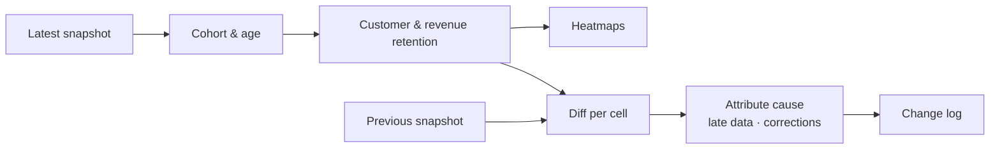
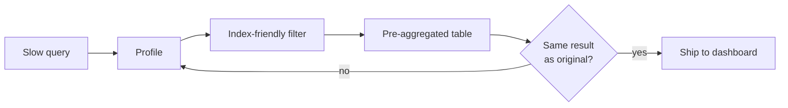
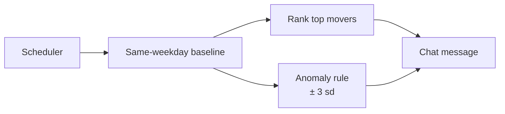
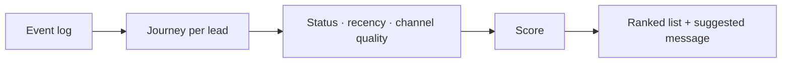
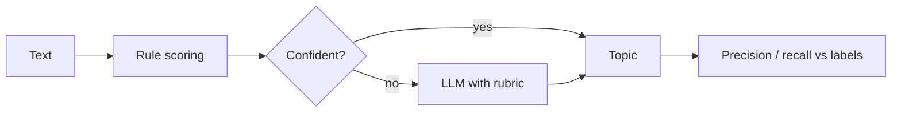

# Data Portfolio — Reiza Sahawaly

Six runnable projects. Each one takes a process that used to be manual or fragile and turns
it into a repeatable system, and measures the **before and after** in code.

> **All data here is synthetic.** Every dataset is generated by `data/generate.py` from a
> fixed seed and describes fictional businesses. None of it comes from any employer.

```bash
pip install -r requirements.txt
python run_all.py          # generate data, run every project, refresh charts
```

Open `docs/index.html` for a one-page visual overview.

## Impact at a glance

| # | System | Before | After |
|---|---|---|---|
| 01 | [Client data cleaning & assignment](projects/01_client_data_cleaning) | 106 "clients" from name variants, revenue off by −42%, 34 payments in the wrong month | 24 real clients, 0% revenue error, every client with one owner |
| 02 | [Subscription & retention tracking](projects/02_retention_cohort) | Refreshes compared by eye, changes unexplained | 100% of changed cohort cells explained automatically in < 1 s |
| 03 | [Query optimization](projects/03_query_optimization) | ~600 ms full scan | 8–20 ms (30–75x), identical results |
| 04 | [Daily change alert](projects/04_daily_change_alert) | Total only, team asks "why?" | Top 5 contributors named, anomalies flagged |
| 05 | [Lead re-engagement](projects/05_lead_reengagement) | Blast to everyone: 13 returns / 300 contacts | Scored list: 30 returns / 300 contacts (2.4x, simulated) |
| 06 | [Text classification](projects/06_feedback_classification) | First keyword wins: 77% accuracy | Rule scoring: 94% accuracy, ambiguous 16% routed to an LLM |

### Full-size versions

Projects 02 and 04 are compact versions of two larger repositories:

- **[saas-cohort-retention](https://github.com/reizaa/saas-cohort-retention)** — monthly SMB / Enterprise
  cohort pipeline (revenue, retention, churn, upgrade/downgrade, NRR) with before/after
  reconciliation, n8n scheduling and a Slack pulse that only posts when numbers reconcile.
- **[revenue-change-tracker](https://github.com/reizaa/revenue-change-tracker)** — daily recurring-revenue
  diff (new / upgrade / downgrade / churn) against yesterday or month start, snapshot guards,
  n8n flows and top movers posted as a Slack thread reply.

## System flows

### 01 · Client data cleaning, subscription status & assignment


### 02 · Subscription & retention tracking


### 03 · Query optimization


### 04 · Daily change alert


### 05 · Lead re-engagement


### 06 · Text classification


## Repository layout

```
data/generate.py          synthetic data for all projects (seeded)
projects/<nn_name>/       one script per project + output/ (before_after, charts, CSVs, summary)
docs/index.html           visual overview with before/after flows
run_all.py                run everything end to end
```

Stack: Python (pandas, NumPy, matplotlib), SQL (SQLite here; PostgreSQL and ClickHouse at work).
